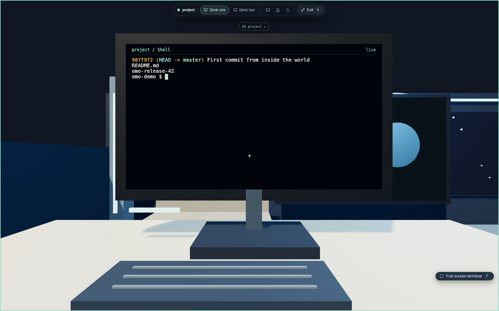
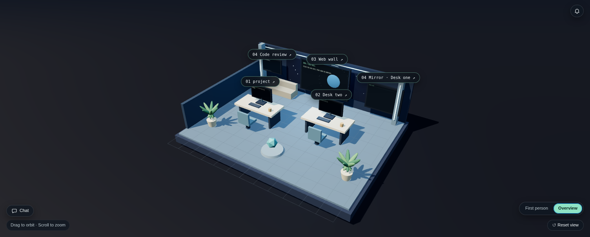

<div align="center">

# omo · spatial IDE

**A first-person, multiplayer IDE. Walk into your project, sit at a desk, and work in a real terminal on a real screen inside the world.**

[Download for macOS (Apple Silicon)](https://github.com/omoresearch/omo-spatial-ide/releases/latest) · [What works today](#status) · [Build from source](#build-from-source) · [Built on Eclipse Theia](#built-on-eclipse-theia)



</div>

## What it is

Omo turns your project into a place. Each project becomes a room with desks, monitors and walls. Every monitor is a live surface: a real terminal, a browser or the code review screen. You walk up to it and use it in place. It has the same tools as a modern IDE (editor, Git, debugger and VS Code extensions), because it is built on [Eclipse Theia](https://theia-ide.org).

It comes from the [Omo Minecraft world](https://github.com/omoresearch/omo-space), where agents such as Hermes, Claude Code and Codex work at desks in a shared world. Omo Spatial IDE brings that way of working to a standalone app.



## Features

- **First-person world.** Walk with WASD and look around with the mouse. Use the overview camera to see the whole room. Press **G** for an immersive full-window world.
- **Physical terminals.** Desk monitors run real shells in persistent tmux sessions. Click a monitor to type on it, or press **F** for a full-screen terminal. Your sessions survive a reload.
- **Agents at desks.** Start Hermes, Claude Code or Codex in a desk tab. Every agent start asks you first. Login, trust and approvals stay inside each agent's own CLI.
- **Web wall.** A sandboxed Chrome view, rendered in the world, for docs, previews and dashboards.
- **Full IDE.** Editor, Git, the debugger and 93 pinned, checksum-verified VS Code extensions. Git review in the world is read-only. You commit with the normal Source Control view.
- **Task workspaces.** Isolated workspaces for agent tasks, with a task overview.
- **Rooms that you shape.** Themes, layouts, room kits, station recipes and presets that you can share. Presets never carry identity or tokens.
- **Together.** Shared rooms with presence, avatars, chat and voice. Today they work on one machine; [cross-computer rooms are in progress](#status).

## Install on macOS

You need an Apple Silicon Mac (M1 to M4) and [Homebrew](https://brew.sh).

```sh
brew install node@22 python tmux bash
brew install --cask google-chrome            # only for the web wall

# Download omo-spatial-ide-<version>-darwin-arm64.tar.gz from the latest release, then:
tar -xzf omo-spatial-ide-*-darwin-arm64.tar.gz
cd omo-spatial-ide-*-darwin-arm64
xattr -dr com.apple.quarantine .             # the build is not code-signed yet
./omo --workspace ~/path/to/your/project
```

Open **http://localhost:3190** in Chrome. Click **Yes, I trust the authors**, choose a world and click **Create my room**. Press **F1** to see the keyboard shortcuts.

Notes:
- Put the folder at a path without spaces.
- Every release checks its `.sha256`. CI builds each macOS package on Apple Silicon and tests the unpacked package before release: the app starts, the 3D room renders in real Chrome, and a real shell runs on an in-world monitor.

## Status

| Area | State |
|---|---|
| First-person room, physical terminals, web wall, IDE tooling | Released (v0.1.0) |
| macOS Apple Silicon download | Released; not code-signed |
| Agents: Hermes, Claude Code, Codex | Integrated; tested with no-network fixture CLIs; supervised real-agent tests next |
| Expandable worlds: build mode, Hermes world admin, prompt-to-world onboarding | In development |
| Multiplayer across computers (room server, invites, voice over the internet) | In development |
| Intel Mac, Linux and Windows downloads; signed `.app`/`.dmg` | Planned |

Omo is early software. Expect rough edges and [tell us what breaks](https://github.com/omoresearch/omo-spatial-ide/issues).

## Build from source

```sh
git clone https://github.com/omoresearch/omo-spatial-ide.git
cd omo-spatial-ide/omo
npm ci
npm run build
npm start -- --workspace /path/to/project      # http://localhost:3190
```

You need Node.js 22+, Python 3.11+, tmux and Chrome. Read these documents:
- [`omo/README.md`](../omo/README.md): the app, its architecture and the tests.
- [`omo/RUNTIME.md`](../omo/RUNTIME.md): the local agent runtime and its safety contract.
- [`omo/MAC-SETUP.md`](../omo/MAC-SETUP.md): macOS details.

The Omo code lives in the additive [`omo/`](../omo) directory. The rest of this repository is upstream Eclipse Theia, unchanged, so we can keep merging upstream releases.

## Security model

- **Local only.** Standalone mode listens only on `127.0.0.1` and trusts the local user.
- **Agents.** No agent starts without your confirmation. Omo never sends a synthetic Enter, never bypasses CLI login or approvals, and never attaches your personal Chrome profile.
- **Browser.** The web wall runs Chrome with its sandbox on.
- **Extensions.** Extensions are pinned and checked against their sha256 before install.

## Built on Eclipse Theia

Omo Spatial IDE is a fork of [eclipse-theia/theia](https://github.com/eclipse-theia/theia). It stays in the upstream fork network and tracks Theia releases (currently 1.74.3). All credit for the IDE platform goes to the Eclipse Theia project and its contributors. Upstream Theia's own README is [`README.md`](../README.md) at the repository root.

## License

Theia's code is under the [Eclipse Public License 2.0](../LICENSE-EPL), with the secondary licenses listed in [`NOTICE.md`](../NOTICE.md). Omo's additions in `omo/` are under the same terms unless a file states otherwise.
